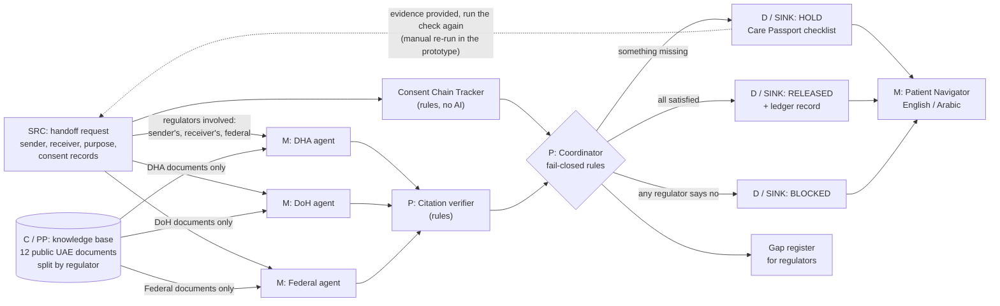

# SovereignGuard

**Team Polaris - ITU AI for Good Sandbox Hackathon, United Arab Emirates (2026)**

SovereignGuard is a multi-agent research prototype that checks each proposed handoff of a patient's health data in the UAE against **every regulator whose rules may apply** - the sender's emirate, the receiver's emirate, and federal law - at the moment of the handoff.

- It **pauses** a handoff when consent does not cover the new purpose, when regulators reach different answers, when the rules are silent, or when a cited clause cannot be matched to the source text.
- It tells the **patient**, in plain English or Arabic, what is needed.
- It writes a full **audit trace** for every run, and a **gap register** of policy silences, regulator disagreements and consent-chain gaps.

> Research prototype. Simulated scenarios only - no real patient data. Not legal advice. The knowledge base contains public documents only.

## Architecture



SRC, C, PP, M, P, D and SINK are the ITU-T Y.3172 machine-learning pipeline nodes. This is an architectural mapping, not a conformance claim. The coordinator asks only the regulators involved in a handoff (the sender's emirate, the receiver's emirate, and federal law), independently and in parallel; each agent sees only its own regulator's documents and never sees the others' answers. In the prototype, a held handoff is re-checked by running it again with the evidence added (scenarios s4 and s5).

## Dashboard (local demo)

The dashboard runs on your own computer; there is no hosted website. The **Scenarios** tab shows every saved run and needs **no API key**.

**Requires Python 3.10 or newer.** Check with `python3 --version`. The Python built into macOS may be 3.9; if so, install Python 3.12 from python.org first.

macOS / Linux:
```bash
git clone https://github.com/Growinggiant576/Sovereignguard.git
cd Sovereignguard
python3 -m venv .venv
.venv/bin/pip install -r requirements.txt
.venv/bin/python -m sovereignguard.kb ingest   # optional: needed only for the Knowledge base tab and live runs
sh run_dashboard.sh                            # then open http://127.0.0.1:8501
```

Windows (PowerShell):
```powershell
git clone https://github.com/Growinggiant576/Sovereignguard.git
cd Sovereignguard
python -m venv .venv
.venv\Scripts\pip install -r requirements.txt
.venv\Scripts\python -m sovereignguard.kb ingest   # optional, as above
.venv\Scripts\streamlit run dashboard.py --server.address 127.0.0.1
```

Tabs:
- **Scenarios:** every saved run, side by side - without SovereignGuard vs with it (outcome, Care Passport checklist, each regulator's decision and quoted clauses, gap register, message to the patient in English or Arabic). No API key, no knowledge-base build needed.
- **Run live:** re-run a scenario with the agents (needs `ANTHROPIC_API_KEY` in `.env` and the knowledge base built; uses API credit).
- **Knowledge base:** search one regulator's documents directly (needs the knowledge base built; runs locally, no key).
- **Architecture:** the diagram above.

The dashboard has no login, so it only runs on `127.0.0.1` and refuses to start on any other address.

## Building blocks

| Building block | Type | File | Function | Reuse in another context |
|---|---|---|---|---|
| Regulator agent (Federal, DHA, DoH) | LLM agent - one class, three instances | `sovereignguard/agents.py` | Reads only its own regulator's partition of the knowledge base; returns PERMIT / PERMIT_WITH_CONDITIONS / BLOCK / SILENT / NOT_APPLICABLE with quoted citations | Point it at another regulator's documents (e.g. two education or two financial regulators) - no code change |
| Consent Chain Tracker | Rule-based, no LLM | `sovereignguard/consent.py` | Ledger of consent purposes and the framework they were recorded under; flags purpose not covered, consent from another regulator, transfer outside the UAE | Any consent-based data sharing; only labels change |
| Coordinator | Rule-based, no LLM | `sovereignguard/orchestrator.py` | Runs the relevant regulator agents independently and in parallel, compares decisions, applies fail-closed rules, writes the gap register | Any multi-authority decision |
| Patient Navigator | LLM agent | `sovereignguard/agents.py` | Plain-language action plan in the patient's language | Any citizen-facing explanation of a multi-agency decision |
| Citation verifier | Rule-based, no LLM | `sovereignguard/agents.py` | Checks every quote appears in the excerpt it cites; an unmatched quote pauses the step | Any retrieval-based assistant |

Outcome rules (in code, not decided by the model): any regulator **BLOCK** -> BLOCK. Otherwise a HIGH consent finding, any PERMIT_WITH_CONDITIONS, any SILENT, or any unverified citation -> **PAUSE** for human review. Only if every applicable regulator permits, no condition is left unmet and the consent chain is intact -> **PROCEED**: the data is released and the handoff is recorded. Unmet conditions from all regulators are merged into one checklist (the Care Passport); add the evidence to the scenario (`evidence_provided`) and run it again, as in `s4`.

## See it without running anything

Every scenario has already been run in both modes. The complete traces are committed in [`runs/`](runs/):

- `runs/<scenario>__ungoverned.md` - data moves with no checks; the consent tracker lists what nobody caught.
- `runs/<scenario>__governed.md` - full multi-agent check: each regulator's decision, conditions, open questions, quotes (marked verified / not verified), gap register and the patient's action plan.
- `.json` files hold the same trace in full, including retrieved passage IDs and distances, model ID, token counts and the knowledge-base fingerprint.

## Reproduce the demo

Prerequisites: Python 3.10+ and an Anthropic API key (governed mode only; ungoverned mode and the knowledge-base build need no key). Tested on macOS (Apple M1 Pro, 16 GB RAM).

```bash
git clone https://github.com/Growinggiant576/Sovereignguard.git
cd Sovereignguard
python3 -m venv .venv
.venv/bin/pip install -r requirements.txt

# 1. Build the vector knowledge base (downloads ChromaDB's local embedding model, all-MiniLM-L6-v2, ~80 MB, once)
.venv/bin/python -m sovereignguard.kb ingest

# 2. Optional: search one regulator's partition directly
.venv/bin/python -m sovereignguard.kb search DOH "share patient data with another healthcare facility consent"

# 3. Run a scenario without governance (no API key needed)
.venv/bin/python -m sovereignguard.run scenarios/s2_research_reuse.json --mode ungoverned

# 4. Run it with governance (needs the key)
echo 'ANTHROPIC_API_KEY=your-key-here' > .env      # .env is git-ignored
.venv/bin/python -m sovereignguard.run scenarios/s2_research_reuse.json --mode governed

# 5. Or run every scenario in both modes
.venv/bin/python -m sovereignguard.run --all
```

Settings (optional environment variables): `SG_MODEL` (default `claude-opus-5-5`), `SG_EFFORT` (default `medium`).

The default model `claude-opus-5-5` (Claude Opus 5.5) was confirmed available through the Anthropic API on 10 Nov 2026; every trace in `runs/` was generated with it (the model ID is recorded in each trace).

## Add your own scenario

Copy any file in `scenarios/`, change the consent records and handoff steps, and run it. Each step needs `from_jurisdiction` / `to_jurisdiction` (`FEDERAL`, `DHA`, `DOH` or `OUTSIDE_UAE`), a `purpose`, `data_categories`, and a plain-language `question`. The coordinator picks the regulators automatically.

## Scenarios included (all simulated)

| File | What happens | Why it matters |
|---|---|---|
| `s1_care_transfer.json` | Patient moves from an Abu Dhabi (DoH) hospital to a Dubai (DHA) hospital; record released for continuing treatment | Consent recorded under one emirate's framework, used under another's |
| `s2_research_reuse.json` | The Dubai hospital shares a "de-identified" copy with an AI research partner, which then processes it on a server outside the UAE | Purpose drift (treatment -> AI training) and cross-border transfer |
| `s3_care_transfer_arabic.json` | Same as s1, patient request and action plan in Arabic | Multi-language citizen interaction (Arabic not yet reviewed by a native speaker) |
| `s5_ai_training_completed.json` | AI-training reuse after the patient opts in, with ethics approval, data-sharing agreement and UAE-only processing | Federal conditions met; DHA lists 4 exact remaining items before release |
| `s4_care_transfer_completed.json` | Same handoff as s1, after the patient signs the consents asked for and the hospitals confirm a signed-referral route | Shows the loop closing: no unmet conditions, data released (PROCEED) |

## Knowledge base

Public UAE documents, partitioned by regulator. Text extracted from the published files (Arabic lines removed from bilingual files; numbering kept). Source URL and access date for every document are in [`kb/manifest.json`](kb/manifest.json); the text is in [`kb/text/`](kb/text/).

| Partition | Document | Issuer | Notes |
|---|---|---|---|
| FEDERAL | [Federal Law No. (2) For the year 2019 On the Use of Information and Communications Technology (ICT) in Healthcare](https://www.dha.gov.ae/uploads/082022/Federal%20Law%20No2022824434.pdf) | Public Health Policies Department, Public health Policy and Licensing Sector (booklet); law issued by the President of the UAE | Bilingual Arabic/English 'An Introductory' booklet of the law (Articles 1-31), hosted on the DHA regulatory-documents portal; not the Official Gazette; English text does not state whether it is an official translation. Arabic-script lines removed during cleaning. |
| FEDERAL | [UAE National Strategy for Artificial Intelligence 2031](https://ai.gov.ae/wp-content/uploads/2021/07/UAE-National-Strategy-for-Artificial-Intelligence-2031.pdf) | UAE Government - Office of the Minister of State for Artificial Intelligence (ai.gov.ae) | Strategy document, not binding regulation. Multi-column layout; extracted reading order may break across columns/page footers. |
| DHA | [NABIDH Policies and Standards](https://nabidh.dha.gov.ae/cms/uploads/5bb756c30fec4f01b04d4e90a635a313.pdf) | Dubai Health Authority (DHA) | Cover: 'Nabidh Policies and Standards (V2.0) Revised on April 2025'; 188 pages; listed on nabidh.dha.gov.ae Policies & Standards page. |
| DHA | [Policy for Health Data and Information Sharing](https://nabidh.dha.gov.ae/cms/uploads/3652b370cb92403191417e920ab0f343.pdf) | Dubai Health Authority | Ref No: DHA/HISHD/PP-13; Version 1; Issue Date 10/08/2024; Effective 10/11/2024; Revision 10/08/2027. Bilingual header boilerplate (Arabic removed). Some tables (e.g., 4.6.5) extract out of order. |
| DHA | [Standards for Health Information Consent and Access Control](https://nabidh.dha.gov.ae/cms/uploads/2e5de3bcf44943dd9f1980f283101b4c.pdf) | Dubai Health Authority | Code: DHA/HISHD/ST-09; Issue 1; Issue Date 02/01/2025; Effective 02/04/2025; Revision 02/01/2030. |
| DHA | [Artificial Intelligence in the Healthcare Policy](https://nabidh.dha.gov.ae/cms/uploads/7c2063bf99f84bdcb88a4dc0933718b2.pdf) | Dubai Health Authority - Health Informatics and Smart Health Department | Document Title field reads 'Artificial Intelligence in the Healthcare'; Ref No: HRS/HISHD/AIP/1/2021; Version 1; Effective 1/7/2021; Revision 1/7/2024 (revision date has passed - may be superseded). Bilingual; Arabic removed. |
| DHA | [Policy for Data and Health Information Protection and Confidentiality](https://www.dha.gov.ae/uploads/082022/Health%20Data%20Protection%20and%20Confidentiality%20Policy_EN2022810559.pdf) | Dubai Health Authority | Code: DHA/HRS/HISHD/PP-11; Version 1; Issue Date 10/08/2022; Effective 10/10/2022. DHA portal lists it as 'Policy for Health Data Protection and Confidentiality'. Bilingual header boilerplate (Arabic removed). |
| DHA | [My Personal Health Data Preferences](https://nabidh.dha.gov.ae/cms/uploads/5285f4bb21d64b6abb17a2e28d55cd4a.pdf) | Dubai Health Authority (NABIDH) | Patient-facing NABIDH leaflet (file name 'NABIDH_Personal Health Data Preferences_EN_v5.1.SECURED.pdf'); informational, not a regulation. |
| DOH | [Policy on the Abu Dhabi Health Information Exchange (HIE)](https://staticcdn.malaffi.ae/wpblobe9e5523f25/2020/04/doh-policy-on-the-adhie-april-2020.pdf) | Department of Health Abu Dhabi (DOH) - Strategy Division | Ref: DOH/POL/STR/HIE/1.1/2020; Effective 16 April 2020; previous version November 2018; Classification: Public. Hosted on Malaffi CDN (linked from malaffi.ae/what-is-malaffi/policies/); doh.gov.ae was unreachable from this network. |
| DOH | [DOH Standard on Patient Healthcare Data Privacy](https://staticcdn.malaffi.ae/wpblobe9e5523f25/2021/02/2020-09-15-DOH-Standard-on-Patient-Healthcare-Data-Privacy-for-publication-2.pdf) | Department of Health Abu Dhabi (DOH) - Support Services Division | Ref: DOH/SD/SS/PHDP/0.9; Effective 16th September 2020; hosted on Malaffi CDN (linked from malaffi.ae policies page). |
| DOH | [Abu Dhabi - Healthcare Information and Cyber Security Standard](https://staticcdn.malaffi.ae/wpblobe9e5523f25/2019/11/ADHICS_Standard-Final.pdf) | Department of Health Abu Dhabi (DOH) | Ref: DOH/SD/ADHICS/0.9; Version 0.9; Publication Date 03 February 2019; hosted on Malaffi CDN (linked from malaffi.ae policies page). Newer ADHICS versions may exist. |
| DOH | [Privacy Notice](https://www.malaffi.ae/privacy-notice/) | Abu Dhabi Health Data Services - Sole Proprietorship LLC (ADHDS) - Malaffi | HTML page; 'VERSION 2.0 PUBLISHED ON 29 September 2022', 'Last updated on 08 May 2025'. Body text only (site navigation removed). Operator's privacy notice, not a DOH regulation. |

**Not obtained (limitation):** the English text of Federal Decree-Law No. 45 of 2021 (personal data protection), Cabinet Resolution No. 32 of 2020 (scanned images only), and policies published on mohap.gov.ae and doh.gov.ae (not downloadable from our network). The federal partition is therefore thin, and agents are instructed to declare silence rather than fill gaps.

## Limitations

- Research prototype on simulated scenarios; regulator agents' interpretations have **not** been reviewed by a lawyer.
- Some documents may have newer versions than the ones we obtained (see notes above).
- Retrieval uses a small general-purpose embedding model; a relevant clause can be missed, which may show up as SILENT.
- The prototype sends only simulated scenarios and public regulation text to the model API. A real deployment must run inside the UAE (a local model, or UAE-hosted cloud infrastructure such as the AWS UAE region `me-central-1`).
- Requires an Anthropic API key for governed mode. An offline local-model option is planned, not yet implemented.
